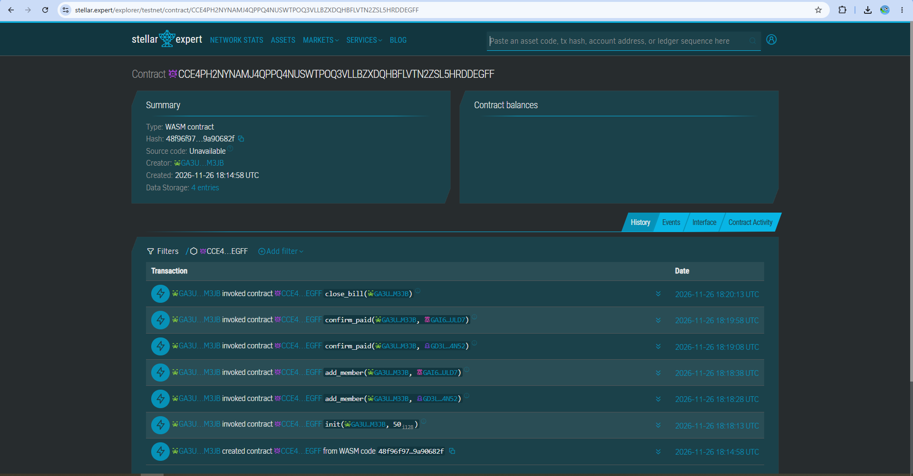

# Project Title

**SplitBill** - a simple bill-splitting tracker for group meals and trips, built as a smart contract on Stellar (Soroban).

## Project Description

After a group meal or trip, one person usually pays the whole bill first and then splits the cost among everyone. It is very easy to forget who has already paid the money back and who has not. SplitBill records this information on the Stellar blockchain so that the list of participants and their payment status is stored in one place that anyone can check but only the bill payer can change.

The contract stores only numbers and statuses: the amount each person has to pay, who is on the list, and whether each person has been marked as paid. It does **not** move any money or token; the actual repayment happens outside the contract, and the bill payer then confirms it on-chain.

## Project Vision

The goal is to give friends, classmates and colleagues a transparent and tamper-resistant way to settle shared expenses without arguments about who still owes money. This project is a first step: a minimal on-chain record that can later grow into a fuller group-expense and payment tool.

## Key Features

- **One-time setup**: the bill payer creates the bill with a fixed amount that each person has to pay. The amount must be greater than 0, and a second initialization is rejected.
- **Add members**: only the bill payer can add a member to the list. Each member can be added only once.
- **Confirm payment**: only the bill payer can mark a member as having repaid their share. Only members on the list can be confirmed, and each member can be confirmed only once. The time of confirmation is recorded.
- **Close the bill**: only the bill payer can close the bill, and only when there is at least one member and every member has been confirmed as paid. A closed bill cannot be changed any more.
- **Public read access**: anyone can view the bill (payer address, amount per person, total members, number of members who have paid, open or closed status, creation time) and the status of any address (on the list or not, paid or not, time of payment).
- **Safe arithmetic and clear errors**: counters use checked arithmetic, and every failure returns a numbered error instead of panicking.
- **Persistent storage**: all data is kept in persistent contract storage, and its time-to-live is extended on every write.

## Usage Instructions

The commands below use Windows PowerShell with the Stellar CLI. They assume a funded testnet identity named `student` and a deployed contract with the alias `my-contract`. Each deployed contract holds one bill; to start a new bill, deploy a new contract.

**1. Build the contract** (from the project root):

```powershell
stellar contract build
```

**2. Deploy to testnet** (the `.wasm` path can differ slightly between CLI versions; check the output folder of the build):

```powershell
stellar contract deploy --wasm target/wasm32v1-none/release/hello_world.wasm --source-account student --network testnet --alias my-contract
```

**3. Create wallets for two members** (they are only used as addresses on the list):

```powershell
stellar keys generate member1 --network testnet --fund
```

```powershell
stellar keys generate member2 --network testnet --fund
```

**4. Try the functions:**

Create the bill with 50 per person:

```powershell
stellar contract invoke --id my-contract --source-account student --network testnet -- init --admin student --share_amount 50
```

View the bill:

```powershell
stellar contract invoke --id my-contract --source-account student --network testnet -- get_bill
```

Add two members:

```powershell
stellar contract invoke --id my-contract --source-account student --network testnet -- add_member --admin student --member member1
```

```powershell
stellar contract invoke --id my-contract --source-account student --network testnet -- add_member --admin student --member member2
```

Confirm that the first member has paid:

```powershell
stellar contract invoke --id my-contract --source-account student --network testnet -- confirm_paid --admin student --member member1
```

View a member's status:

```powershell
stellar contract invoke --id my-contract --source-account student --network testnet -- get_member --member member1
```

Confirm the second member, then close the bill:

```powershell
stellar contract invoke --id my-contract --source-account student --network testnet -- confirm_paid --admin student --member member2
```

```powershell
stellar contract invoke --id my-contract --source-account student --network testnet -- close_bill --admin student
```

**5. Try calls that should fail:**

Confirming the same member twice returns error `#7` (`AlreadyPaid`):

```powershell
stellar contract invoke --id my-contract --source-account student --network testnet -- confirm_paid --admin student --member member1
```

Closing the bill while someone has not paid returns error `#9` (`UnpaidRemaining`); run this before confirming the last member:

```powershell
stellar contract invoke --id my-contract --source-account student --network testnet -- close_bill --admin student
```

## Future Scope

The following ideas are **not** implemented in the current contract:

- Support for several bills in one contract, each with its own payer.
- Different amounts for different members, or splitting a total automatically.
- Removing a member or changing the amount per person before anyone has paid.
- Letting members confirm their own payment, or the payer confirming partial payments.
- Transferring the role of bill payer to another address.
- Emitting events when members are added or confirmed so that apps can track activity.
- Real on-chain payment with a Stellar token or stablecoin instead of manual confirmation.
- A simple web or mobile interface for creating and tracking bills.
- A test suite and security review before any production use.

## Technology Stack

- **Blockchain**: Stellar (testnet)
- **Smart contract platform**: Soroban
- **Language**: Rust (`#![no_std]`, compiled to WebAssembly)
- **SDK**: `soroban-sdk` version 29
- **Tooling**: Stellar CLI (`stellar contract init`, `build`, `deploy`, `invoke`)
- **Environment**: Windows PowerShell

## Contract Detail

Contract ID:

Deployer:



### Functions

| Function | Parameters | Caller | Description |
|---|---|---|---|
| `init` | `admin`, `share_amount` | Bill payer (once) | Creates the bill with the amount each person has to pay; the bill starts open. |
| `add_member` | `admin`, `member` | Bill payer | Adds a member to the list and returns the total number of members. |
| `confirm_paid` | `admin`, `member` | Bill payer | Marks a member as paid and returns the number of members who have paid. |
| `close_bill` | `admin` | Bill payer | Closes the bill once every member has paid. |
| `get_bill` | none | Anyone | Returns `admin`, `share_amount`, `total_members`, `paid_members`, `open` and `created_at`. |
| `get_member` | `member` | Anyone | Returns `listed`, `paid` and `paid_at`. An address that was never added shows all false and 0. |

### Stored Data

- **Bill**: payer address, amount per person, total members, members who have paid, open or closed status, creation time (ledger timestamp).
- **Member** (one per address): on the list or not, paid or not, time of payment (ledger timestamp).

### Error Codes

| Code | Name | Meaning |
|---|---|---|
| 1 | `AlreadyInitialized` | The bill has already been created. |
| 2 | `NotInitialized` | The bill has not been created yet. |
| 3 | `NotAdmin` | The caller is not the bill payer. |
| 4 | `InvalidAmount` | The amount per person is 0 or negative. |
| 5 | `AlreadyAdded` | The member is already on the list. |
| 6 | `NotMember` | The address is not on the list. |
| 7 | `AlreadyPaid` | The member has already been confirmed as paid. |
| 8 | `BillClosed` | The bill is closed and can no longer be changed. |
| 9 | `UnpaidRemaining` | At least one member has not paid yet. |
| 10 | `NoMembers` | The bill has no members. |
| 11 | `Overflow` | A counter overflowed. |